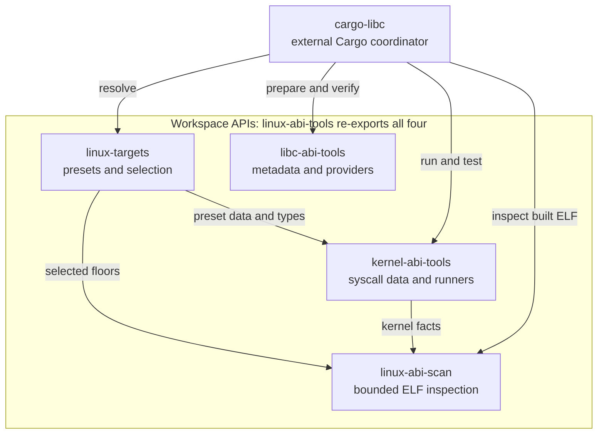
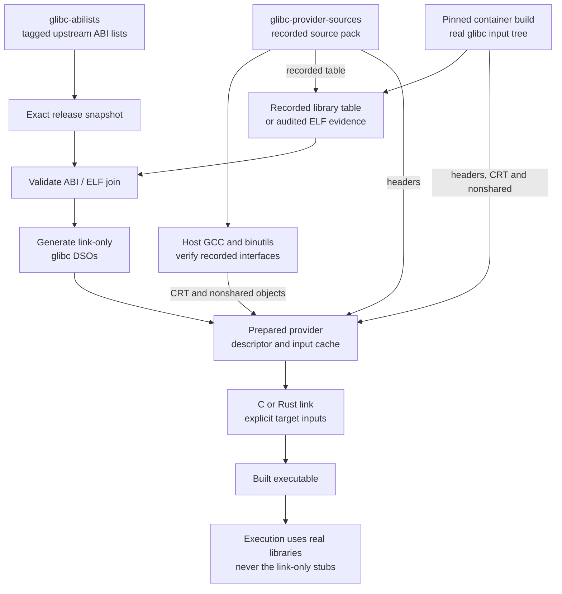

# Architecture

## Implemented workspace boundaries

Arrows below identify API calls or shared data, not a promise of runtime
compatibility. The umbrella is a library of re-exports; cargo-libc is the
separate Cargo coordinator, not a workspace crate.

The boundaries follow the five manifests, [umbrella re-exports](../crates/linux-abi-tools/src/lib.rs),
[Selection](../crates/linux-targets/src/lib.rs), [runner/data APIs](../crates/kernel-abi-tools/src/lib.rs)
and [scan entry points](../crates/linux-abi-scan/src/lib.rs). Scanner inspection
never executes the input. Local simulation uses host userland; container
simulation uses image userland on the host kernel. Their shared data covers
native x86_64 syscall availability and madvise advice, not arbitrary kernel
behavior or OCI foreign-ABI errno parity.

## Implemented provider data flow

The two preparation routes are alternatives, not an automatic fallback.
Source mode uses recorded library tables without rebuilding real glibc DSOs;
container mode measures its pinned build's real DSOs. Both supply link inputs,
not a replacement runtime.

[Preparation](../src/provider/prepare.rs) also generates the link-only libgcc_s
stub from the recorded GCC 4.8.5 table, selects host GCC startup objects and
keys the cache by tool version/inputs. [Object verification](../src/provider/build.rs)
refuses unreviewed differences. The container route retains real runtime
libraries for tests; source mode's loader file is a link stub, never executed.
See [provider details and limits](USING-PROVIDERS.md).

An explicit target-link transformation is available separately from the raw
provider paths shown above: [`provider::link_profile`](../src/provider/link_profile.rs)
validates actual selected libc/librt files, then derives a content-addressed
one-library librt overlay. It changes only the five applicable clock versym
nondefault bits, preserving every other byte. Inputs may also come from a full
sysroot or explicit provider. The caller owns containment, search-prefix or
identity-checked same-position substitution and fingerprinting; argument order,
provider descriptors and raw recorded evidence remain unchanged. See the
[overlay contract](USING-PROVIDERS.md#derived-clock-link-overlay-api), LAT-REQ-029.
This API is [published in 0.4.0](RELEASING.md#published-040-archives-and-documentation);
the immutable 0.3.3 snapshot does not include it.

Both diagrams show implemented paths only. Compact ABI database work remains
[planned](ROADMAP.md#glibc-data-and-abi-metadata); authenticated prebuilt delivery
is [deferred pending legal review](ROADMAP.md#provider-delivery). Tier 3 actual
old-kernel/userland qualification remains [unavailable and deferred](ROADMAP.md#deferred-qualification),
not an ordinary-release blocker. No arrow from linking, scanning or modern-host
simulation establishes tier 3 compatibility.

The existing trace covers these views: LAT-REQ-001–004, LAT-REQ-008–013,
LAT-REQ-015–023 and LAT-REQ-027–028 in [REQUIREMENTS.md](REQUIREMENTS.md).

`version.rs` parses numeric symbol versions independently of release policy.
`glibc.rs` owns glibc file layouts, parser rules, release snapshots, and source
collection. `main.rs` handles CLI arguments and presentation. The root crate uses
only the standard library and the optional rustcommons
`glibc-abilists` and `glibc-provider-sources` inputs; see the feature declarations
in [Cargo.toml](../Cargo.toml). The kernel local runner uses platform FFI in an
explicit unsafe boundary; this workspace is not an unsafe-free runtime.

`elf.rs` separately collects SONAME and defined dynamic-symbol evidence from
bounded ELF64 x86_64 inputs, including GNU default versions, binding, visibility,
IFUNC/TLS kinds, and 64-bit sizes. It records same-range groups without inferring
semantic aliases or source releases. See [ELF metadata](ELF-METADATA.md).

## Inputs and invariants

- Targets: x86_64 GNU/Linux only. Data under `x86_64/64` excludes the x32 ABI.
- Release directories: glibc 2.17+; 2.17–2.19 use the historical `nptl` subdirectory.
- Versions below 2.17 are still parsed when attached to symbols.
- Old lists group indented rows under a `GLIBC_*` line. New lists repeat that
  version on each row. Both produce the same `Symbol` representation.
- A symbol retains its name, version, and kind (`F`, `D` + size, or explicit `T`
  + size). `A` version-node markers and `GCC_*` rows are not exported.
- Unknown/nonnumeric namespaces, unknown kinds, conflicting duplicates, and
  malformed or oversized sizes are errors with file/line context.
- Library order in exported TSV is lexical; symbols sort by name then numeric
  version. No timestamps or absolute build paths appear in output.
- Each required input is limited to 10 MiB. All eight library files must exist;
  a missing file is not interpreted as an empty library.
- Canonical file paths must remain inside the source release directory.

## Exact snapshots versus consolidation

Each snapshot comes entirely from that release's own ABI files. This preserves
actual library membership and avoids applying a newer library location to an
older target. For example, `pthread_sigmask` appears in libc in 2.32 with older
version tags; that does not make it a libc export on 2.31.

Zig's pinned consolidator processes release history to encode inclusions into
one compact binary database. Our first milestone does not port that algorithm
or its binary format. Exact snapshots provide testable source evidence for that
next phase. The pinned Zig consolidator skips grouped files before 2.23; this
parser deliberately adds that format to inspect the 2.17 baseline directly.

## What ABI lists cannot establish

The supplied glibc lists identify F/D/A entries. They do not provide all ELF
default-version, visibility, weak binding, alias, or TLS details. Parsing explicit
T entries does not mean the bundled files fully identify thread-local exports.
Those gaps require authoritative ELF/source evidence before generating DSOs.

Link-only DSOs also cannot replace real CRT/nonshared code, libc implementations,
headers, or compiler runtimes. cargo-libc consumes this workspace's metadata
and provider APIs and can prepare a provider automatically in `source` or
`container` mode. Explicit sysroots remain an alternative; see
[Using providers](USING-PROVIDERS.md).

The standalone Cargo example `minimal_glibc_stub` exercises assembly/version
script generation for two glibc 2.17 functions. It requires reference ELF evidence
and derives bindings through `elf.rs`; default-version policy is explicitly
limited to those exports and checked against real ELF
libraries in the two-path C experiment. It does not extend the metadata library
or CLI into a general generator. Real startup/nonshared inputs remain separate;
see [the example](../examples/glibc-two-paths/README.md).

`stub.rs` is a separate experimental source emitter for selected versioned ELF
definitions, including IFUNC, objects, and TLS. It preserves exact observed
shared ranges, preserves overlapping data views, and rejects incompatible/code
overlaps. `render_glibc` adds the exact snapshot/SONAME/membership/kind/size join.
The full pinned 2.17 public ABI experiment passes C/Rust checks with both real
input trees. The [version-1 provider contract](PROVIDER-CONTRACT.md) now joins
these local artifacts to `cargo-libc`; authenticated release SDK packaging remains
future work. Cargo preserves host build units, selects explicit target inputs,
and checks direct ELF requirements; independent experiments audit link/runtime paths.
See [stub generation](STUB-GENERATION.md) and [full libraries](FULL-LIBRARIES.md).

## Workspace boundaries

`linux-targets` resolves floors and presets; `kernel-abi-tools` derives syscall
availability and local BPF/OCI simulation from shared data; `linux-abi-scan`
performs tier 1 inspection with explicit parser/work/site limits. Their APIs
are re-exported by the library-only `linux-abi-tools` package. See the
[requirements index](REQUIREMENTS.md) for implementation and bounded evidence.
A clean scan or modern-host simulation is not real old-system qualification.

## Updating upstream

ABI lists are updated in [glibc-abilists](https://github.com/rustcommons/glibc-abilists):
extend its `upstream.toml` range, add the new release manager's key if needed,
and rerun its collector, which verifies the tag signature, mirror agreement,
and license, and records each file's provenance. Then update the dependency
here, run the all-release regression tests, regenerate the reference with
`scripts/build-glibc-reference.py`, and review the ABI diffs. Do not relabel an
unqualified release as a supported runtime target. Code adapted from Zig keeps
its MIT notice.

## Provider release selection

The unchanged six-field v1 descriptor now selects exactly one release from 2.17 through 2.44 (`RELEASES` in `src/provider.rs`), and cargo-libc rejects mismatched requests before building. The source-built profiles contain 2921 (2.18–2.21) to 4315 (2.44) public definitions across eight generated DSOs, including the 2.34 merger, after which libpthread, libdl, librt and libutil are small placeholders; before 2.28 the provider also links `libpthread_nonshared.a`, which 2.28 merged into `libc_nonshared.a`. Existing 2.17 descriptors and both input routes remain valid. Shared validation scripts select the release explicitly, including pthread default-attribute, sigvec default-removal, and fmemopen version boundaries, compatibility-only rejection, and matrix-selected Cargo newer-symbol rejection tests. See the [provider index](PROVIDERS.md) and the per-release documents it links; actual distribution qualification remains separate.
